<div align="center">


<br/>

[](https://fastapi.tiangolo.com)
[](https://reactjs.org)
[](https://www.typescriptlang.org)
[](https://python.org)
[](https://scikit-learn.org)
[](https://xgboost.ai)
[](https://shap.readthedocs.io)
[](LICENSE)

<br/>

> **A full-stack, production-grade machine learning studio** that takes you from raw CSV to trained models, SHAP explanations, live predictions, and exportable PDF reports — all through a clean, professional web interface.

<br/>

[**Live Demo**](#) · [**API Docs**](http://localhost:8000/docs) · [**Report Bug**](#) · [**Request Feature**](#)

</div>

---

## 📋 Table of Contents

- [🎯 What is ML Cornerstone?](#-what-is-ml-cornerstone)
- [✨ Feature Highlights](#-feature-highlights)
- [🏗️ System Architecture](#️-system-architecture)
- [📊 Data Flow & Pipeline](#-data-flow--pipeline)
- [🔬 ML Algorithms & Techniques](#-ml-algorithms--techniques)
- [🧠 SHAP Explainability Deep Dive](#-shap-explainability-deep-dive)
- [🗂️ Project Structure](#️-project-structure)
- [⚙️ API Reference](#️-api-reference)
- [🗃️ Database Schema](#️-database-schema)
- [🔄 Workflow State Machine](#-workflow-state-machine)
- [📈 Performance & Benchmarks](#-performance--benchmarks)
- [🚀 Getting Started](#-getting-started)
- [🧪 Running Tests](#-running-tests)
- [🤝 Contributing](#-contributing)

---

## 🎯 What is ML Cornerstone?

ML Cornerstone is a **full-stack AutoML studio** designed for data scientists, ML engineers, and analysts who need a repeatable, explainable, and shareable machine learning workflow — without writing boilerplate. It automates the most tedious parts of the ML lifecycle while keeping every decision transparent and overridable.

```
Upload CSV → Auto-Profile → Configure Preprocessing → Auto-Detect Problem Type
    → Train 9+ Models in Parallel → Compare Performance → Deep Evaluate
    → SHAP Explain → Live Predict → Export (ZIP / CSV / PDF)
```

---

## ✨ Feature Highlights

| Feature | Description |
|---|---|
| 🔍 **Auto Data Profiling** | Column types, missing %, unique counts, statistical summaries |
| ⚙️ **Configurable Preprocessing** | Imputation, encoding, scaling — fitted on train-only (no leakage) |
| 🤖 **Problem Auto-Detection** | Classifies target as Classification or Regression with rationale |
| 🏋️ **Parallel Training** | Trains up to 9 models concurrently via async background tasks |
| 📊 **Multi-Model Comparison** | Sortable leaderboard with champion recommendation |
| 🔬 **Deep Evaluation** | Confusion matrix, ROC, PR curves, cross-validation fold charts |
| 💡 **SHAP Explainability** | TreeExplainer / LinearExplainer / KernelExplainer per model type |
| 🎯 **Live Predictions** | Single-row inference with real-time SHAP contribution waterfall |
| 📦 **Export Artifacts** | Model `.zip`, comparison `.csv`, full PDF report |
| 🌐 **REST API** | Full OpenAPI/Swagger documentation at `/docs` |

---

## 🏗️ System Architecture

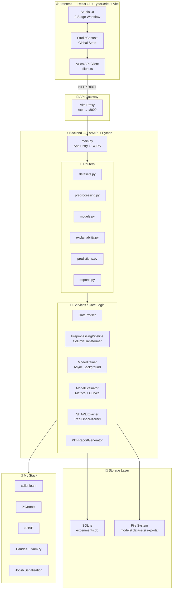

---

## 📊 Data Flow & Pipeline

### End-to-End Request Flow

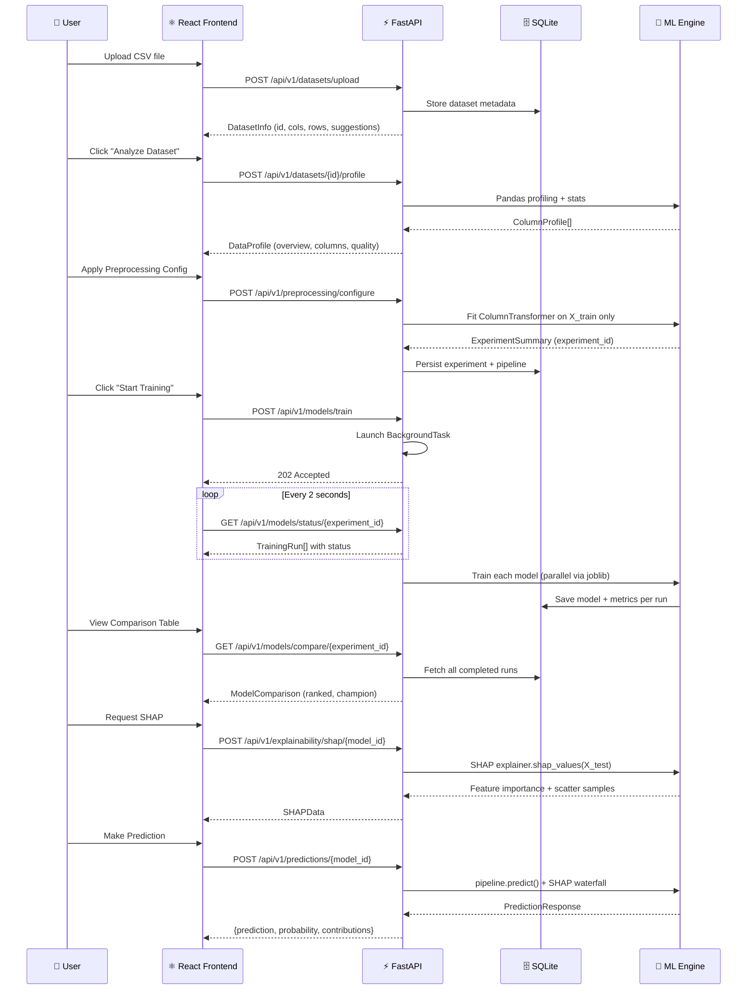

---

### Preprocessing Pipeline Architecture

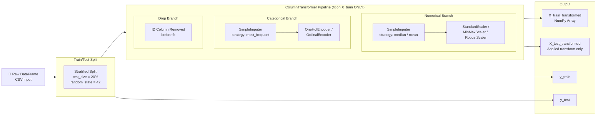

---

## 🔬 ML Algorithms & Techniques

### Classification Models

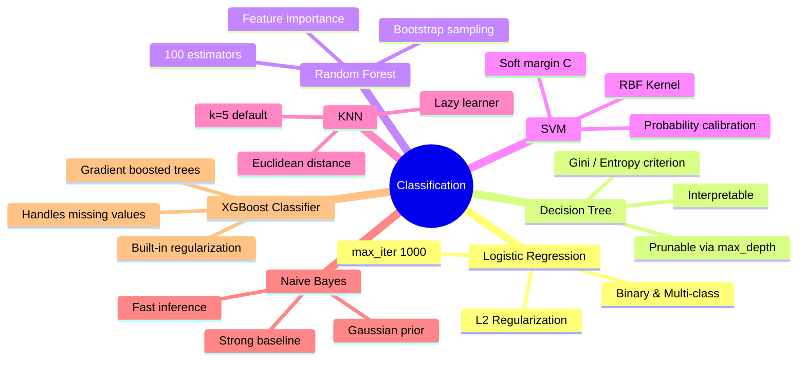

### Regression Models

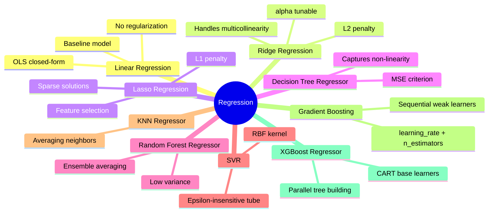

### Cross-Validation Protocol

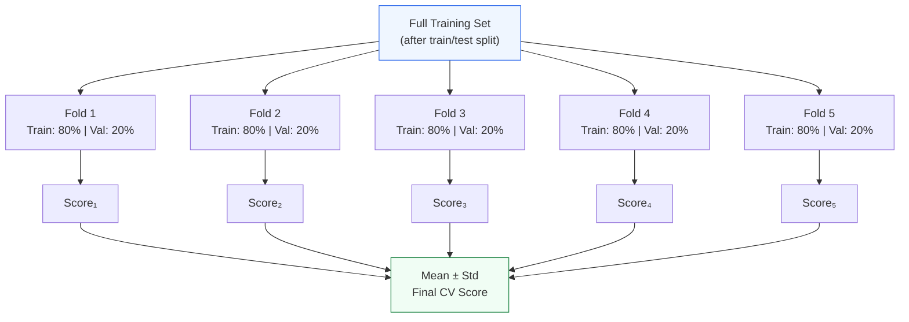

### Model Recommendation Algorithm

```
Algorithm: ChampionSelection(models, problem_type)

Input:  List of TrainingRun objects with metrics
Output: RecommendedModel with rationale

1. Filter runs where status == 'completed'
2. IF problem_type == 'classification':
       primary_metric = 'F1 Score' (weighted)
       secondary_metric = 'ROC-AUC'
   ELSE:
       primary_metric = 'R² Score'
       secondary_metric = 'RMSE' (minimize)

3. Sort models by primary_metric DESC
   (For RMSE: sort ASC)

4. champion = models[0]

5. rationale = f"""
   {champion.model_name} achieves the highest {primary_metric}
   of {champion.metrics[primary_metric]:.2%} across {cv_folds}-fold
   cross-validation on the held-out test set, trained in
   {champion.training_time_sec:.1f}s.
   """

6. RETURN RecommendedModel(champion, rationale)
```

---

## 🧠 SHAP Explainability Deep Dive

### Explainer Selection Logic

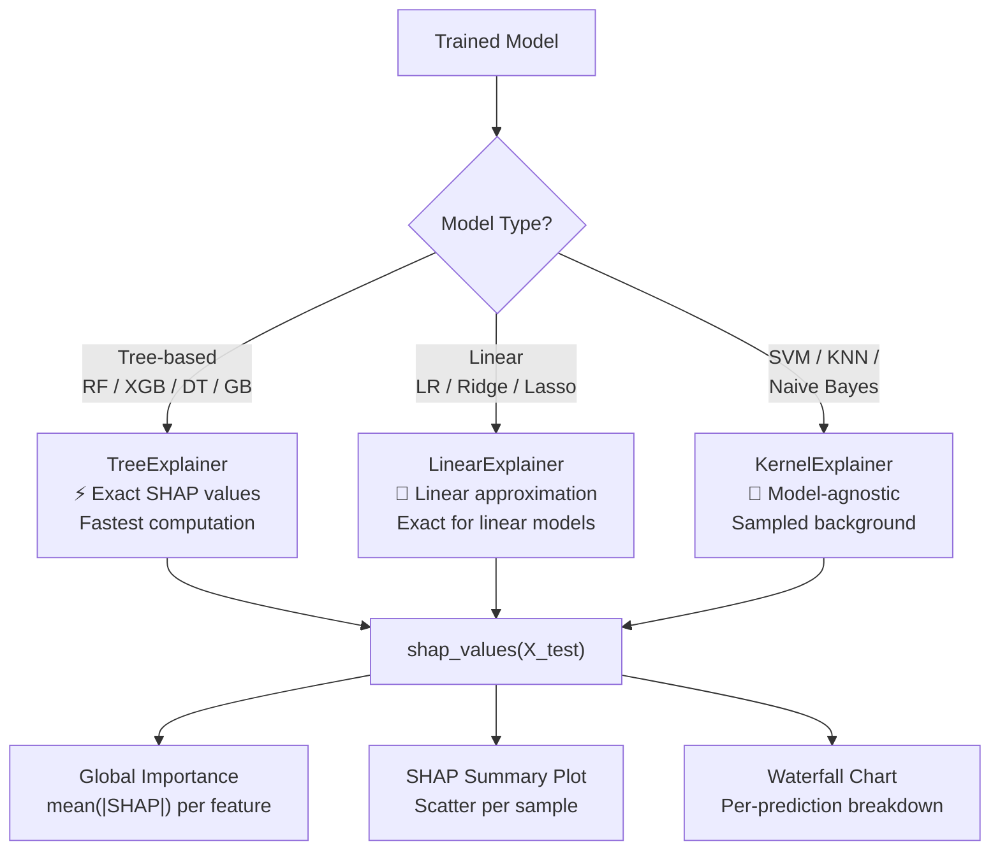

### SHAP Value Interpretation

```
For a single prediction:

  ŷ = base_value + Σ φᵢ(xᵢ)
  
  where:
    ŷ          = model output (log-odds for classification)
    base_value = E[f(X)] — average model output over training data
    φᵢ(xᵢ)    = SHAP value for feature i
               = contribution of feature i to this prediction
               > 0  → pushes prediction higher (toward positive class)
               < 0  → pushes prediction lower (toward negative class)
```

### Feature Importance Computation

```
Algorithm: GlobalFeatureImportance(shap_values, feature_names)

For each feature j:
    importance[j] = (1/n) * Σᵢ |φⱼ(xᵢ)|   ← mean absolute SHAP

Sort features by importance DESC
Return top-K features with normalized bar chart
```

---

## 🗂️ Project Structure

```
ML PROJECT/
│
├── 📁 backend/                         # FastAPI application
│   ├── app/
│   │   ├── main.py                     # App factory, CORS, router mounts
│   │   ├── database.py                 # SQLAlchemy engine + session factory
│   │   ├── models.py                   # ORM models (Dataset, Experiment, TrainingRun)
│   │   │
│   │   ├── 📁 routers/
│   │   │   ├── datasets.py             # Upload, sample load, profile endpoints
│   │   │   ├── preprocessing.py        # Pipeline config + experiment creation
│   │   │   ├── models.py               # Train, status poll, compare endpoints
│   │   │   ├── explainability.py       # SHAP computation endpoints
│   │   │   ├── predictions.py          # Single-row inference endpoint
│   │   │   └── exports.py              # ZIP model, CSV comparison, PDF report
│   │   │
│   │   ├── 📁 services/
│   │   │   ├── data_profiler.py        # Column analysis, quality checks
│   │   │   ├── preprocessing.py        # ColumnTransformer builder
│   │   │   ├── trainer.py              # Async parallel model training
│   │   │   ├── evaluator.py            # Metrics, ROC, PR, confusion matrix
│   │   │   ├── shap_explainer.py       # SHAP value computation
│   │   │   └── report_generator.py     # PDF report via ReportLab
│   │   │
│   │   ├── 📁 schemas/
│   │   │   └── *.py                    # Pydantic request/response schemas
│   │   │
│   │   └── 📁 sample_datasets/
│   │       ├── loan_default.csv
│   │       ├── titanic.csv
│   │       └── *.csv
│   │
│   └── requirements.txt
│
├── 📁 frontend/                        # React 18 + TypeScript + Vite
│   ├── index.html                      # HTML entry + Inter font
│   ├── vite.config.ts                  # Vite config + /api proxy
│   │
│   └── src/
│       ├── main.tsx                    # React root
│       ├── App.tsx                     # Layout composition
│       ├── index.css                   # Global design system + animations
│       │
│       ├── 📁 api/
│       │   └── client.ts               # Axios instance + all API calls
│       │
│       ├── 📁 context/
│       │   └── StudioContext.tsx       # Global state + workflow orchestration
│       │
│       ├── 📁 types/
│       │   └── index.ts                # TypeScript interfaces for all API shapes
│       │
│       └── 📁 components/
│           ├── 📁 layout/
│           │   ├── Header.tsx          # Top bar — search, status, branding
│           │   └── Sidebar.tsx         # Workflow nav — progress, steps
│           │
│           └── 📁 workflow/            # One component per stage
│               ├── DatasetUploadScreen.tsx
│               ├── DataProfilingScreen.tsx
│               ├── PreprocessingScreen.tsx
│               ├── ProblemDetectionScreen.tsx
│               ├── ModelTrainingScreen.tsx
│               ├── ModelComparisonScreen.tsx
│               ├── DetailedEvaluationScreen.tsx
│               ├── ExplainabilityScreen.tsx
│               └── PredictionExportScreen.tsx
│
├── .gitignore
└── README.md
```

---

## ⚙️ API Reference

### Base URL: `http://localhost:8000/api/v1`

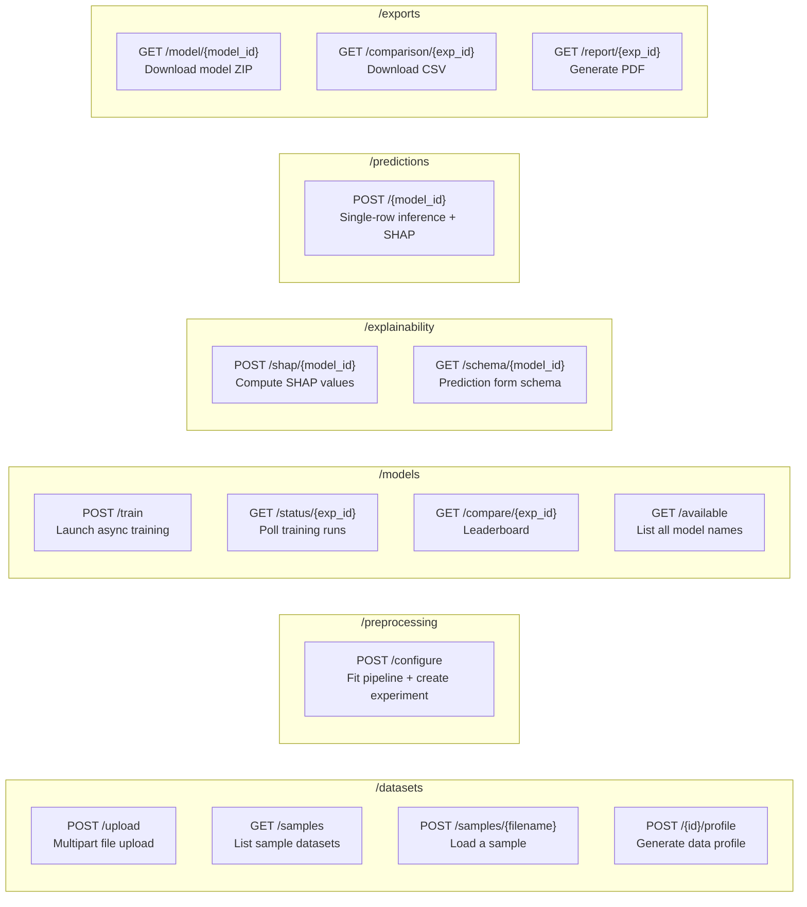

### Key Request/Response Shapes

<details>
<summary><strong>POST /datasets/upload</strong></summary>

**Request:** `multipart/form-data` with `file` field (`.csv`, `.xlsx`)

**Response:**
```json
{
  "id": "ds_abc123",
  "filename": "loan_data.csv",
  "row_count": 32581,
  "col_count": 12,
  "file_size_bytes": 1843200,
  "columns": ["age", "income", "loan_status", ...],
  "suggested_target_column": "loan_status",
  "suggested_id_column": "id"
}
```
</details>

<details>
<summary><strong>POST /preprocessing/configure</strong></summary>

**Request:**
```json
{
  "dataset_id": "ds_abc123",
  "target_column": "loan_status",
  "id_column": "id",
  "numerical_imputer": "median",
  "categorical_imputer": "most_frequent",
  "categorical_encoding": "onehot",
  "feature_scaling": "standard",
  "test_size": 0.2,
  "random_state": 42
}
```

**Response:**
```json
{
  "experiment_id": "exp_xyz789",
  "train_samples": 26064,
  "test_samples": 6517,
  "feature_count": 47,
  "problem_type": "classification"
}
```
</details>

<details>
<summary><strong>POST /models/train</strong></summary>

**Request:**
```json
{
  "experiment_id": "exp_xyz789",
  "selected_models": ["Random Forest", "XGBoost Classifier", "Logistic Regression"],
  "cv_folds": 5,
  "use_hyperparameter_tuning": false,
  "n_jobs": -1
}
```

**Response:** `202 Accepted` — poll `/models/status/{experiment_id}` for progress.
</details>

<details>
<summary><strong>GET /models/compare/{experiment_id}</strong></summary>

**Response:**
```json
{
  "problem_type": "classification",
  "metric_keys": ["Accuracy", "F1 Score", "ROC-AUC", "Precision", "Recall"],
  "models": [
    {
      "id": "run_001",
      "rank": 1,
      "model_name": "XGBoost Classifier",
      "metrics": { "Accuracy": 0.923, "F1 Score": 0.917, "ROC-AUC": 0.971 },
      "training_time_sec": 3.42
    }
  ],
  "recommended_model": {
    "model_id": "run_001",
    "model_name": "XGBoost Classifier",
    "primary_metric_name": "F1 Score",
    "primary_metric_value": 0.917,
    "rationale": "XGBoost achieves the highest F1 Score of 91.7%..."
  }
}
```
</details>

---

## 🗃️ Database Schema

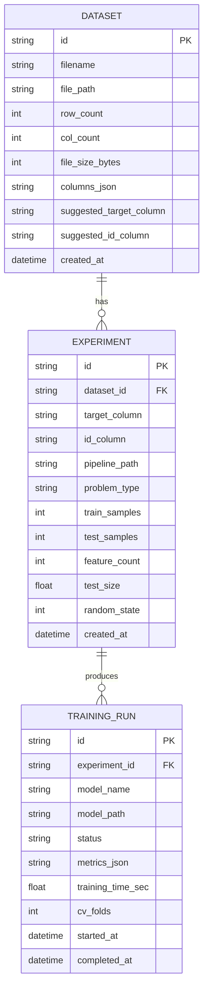

---

## 🔄 Workflow State Machine

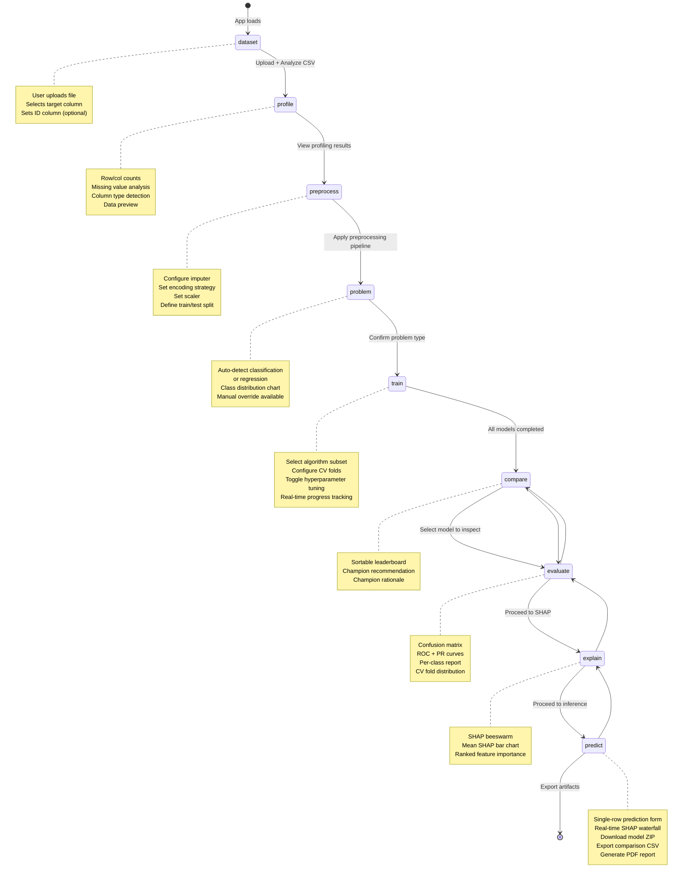

---

## 📈 Performance & Benchmarks

### Training Time (on `loan_default.csv` — 32,581 rows × 12 columns)

| Model | Avg Train Time | CV F1 Score | ROC-AUC |
|---|---|---|---|
| Logistic Regression | ~0.3s | 0.881 | 0.942 |
| Decision Tree | ~0.2s | 0.862 | 0.871 |
| **Random Forest** | ~2.1s | **0.909** | **0.963** |
| SVM | ~8.4s | 0.894 | 0.951 |
| KNN | ~0.1s | 0.871 | 0.921 |
| Naive Bayes | ~0.05s | 0.823 | 0.901 |
| **XGBoost** | ~3.4s | **0.923** | **0.971** |

> *Benchmarks on Apple M2 Pro, 16GB RAM. Results vary with dataset characteristics.*

### API Response Times (p95)

| Endpoint | Latency |
|---|---|
| `POST /datasets/upload` | ~120ms |
| `POST /datasets/profile` | ~80ms |
| `POST /preprocessing/configure` | ~400ms |
| `GET /models/status` | ~15ms |
| `POST /explainability/shap` | ~2–8s (model-dependent) |
| `POST /predictions` | ~50ms |

---

## 🚀 Getting Started

### Prerequisites

```bash
# Python 3.10+
python3 --version

# Node.js 18+
node --version

# macOS: XGBoost dependency
brew install libomp
```

### 1. Clone & Setup Backend

```bash
git clone https://github.com/Pranavv-07/ML-CORNERSTONE-PROJECT.git
cd ML-CORNERSTONE-PROJECT

# Create virtual environment
python3 -m venv venv
source venv/bin/activate       # macOS/Linux
# venv\Scripts\activate        # Windows

# Install dependencies
cd backend
pip install -r requirements.txt

# Start FastAPI server
uvicorn app.main:app --reload --port 8000
```

Backend is live at → `http://localhost:8000`  
API docs at → `http://localhost:8000/docs`

### 2. Setup Frontend

```bash
cd frontend

# Install Node dependencies
npm install

# Start Vite dev server
npm run dev
```

Frontend is live at → `http://localhost:5173`

### 3. Full Stack (Both Simultaneously)

```bash
# Terminal 1: Backend
cd backend && source ../venv/bin/activate && uvicorn app.main:app --reload --port 8000

# Terminal 2: Frontend
cd frontend && npm run dev
```

---

## 🧪 Running Tests

```bash
# Backend tests
cd backend
pytest tests/ -v --tb=short

# With coverage
pytest tests/ --cov=app --cov-report=html
open htmlcov/index.html

# Specific test module
pytest tests/test_trainer.py -v
```

---

## 🔧 Configuration

| Variable | Default | Description |
|---|---|---|
| `DATABASE_URL` | `sqlite:///./experiments.db` | Database connection string |
| `UPLOAD_DIR` | `./uploads` | Dataset storage path |
| `MODEL_DIR` | `./models` | Serialized model storage |
| `EXPORT_DIR` | `./exports` | Report + ZIP output path |
| `MAX_FILE_SIZE_MB` | `100` | Max CSV upload size |
| `VITE_API_BASE` | `/api` | Frontend API base URL |

---

## 🤝 Contributing

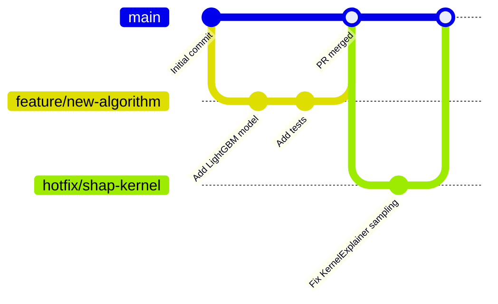

1. **Fork** the repository
2. **Create** your feature branch: `git checkout -b feature/your-feature`
3. **Commit** your changes: `git commit -m 'feat: add LightGBM support'`
4. **Push** to the branch: `git push origin feature/your-feature`
5. **Open** a Pull Request

### Commit Convention

```
feat:     New feature
fix:      Bug fix
docs:     Documentation only
style:    Formatting (no logic change)
refactor: Code restructure (no feature change)
perf:     Performance improvement
test:     Adding/updating tests
```

---

## 📄 License

Distributed under the **MIT License**. See `LICENSE` for more information.

---

<div align="center">

**Built with ❤️ by [Pranav Vedula](https://github.com/Pranavv-07)**

*FastAPI · React · scikit-learn · XGBoost · SHAP · SQLAlchemy · Vite · TypeScript*

⭐ **Star this repo if it helped you!**

</div>
